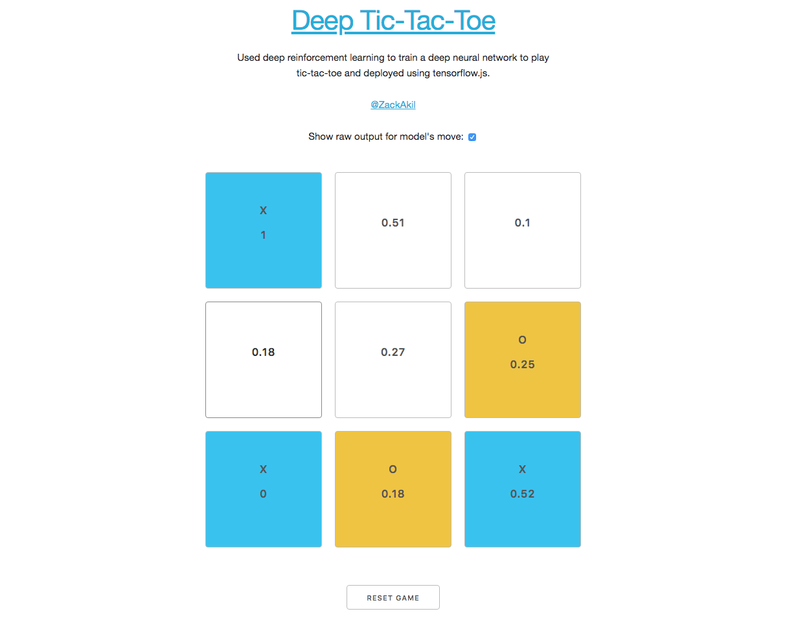

# Deep Tic-Tac-Toe [Play game](https://zackakil.github.io/deep-tic-tac-toe)

This project uses deep reinforcement learning to train a neural network to play Tic-Tac-Toe. The trained model is deployed in a web browser using TensorFlow.js.

## How it Works

The project consists of two main components:

1. **Model Training (Python):**  A Jupyter Notebook (`deep_learning_tic_tac-toe_model_training.ipynb` and `[player_goes_first]_deep_learning_tic_tac_toe_model_training.ipynb`) handles training the neural network.  It uses a convolutional neural network (CNN) built with Keras. The training process involves:

    * **Game Environment:** A custom `XandOs` class simulates the Tic-Tac-Toe environment, allowing the agent to interact with it.
    * **Reinforcement Learning:** The agent learns through experience by playing against a random agent.  Rewards are assigned for wins, losses, ties, and invalid moves.
    * **Experience Replay:**  Game states, actions, and rewards are stored in a memory buffer (`memory`). The agent learns from a batch of randomly sampled experiences from this buffer, improving stability and convergence.
    * **CNN Architecture:** The CNN takes the current game board (represented as a 3x3x2 tensor, where the two channels indicate player 1 and player 2's marks) as input and outputs a probability distribution over the 9 possible moves.
    * **Training Loop:** The agent repeatedly plays games, stores experiences in memory, and updates the CNN's weights based on the rewards received.
   

2. **Web Deployment (TensorFlow.js):**  The trained model is converted to a TensorFlow.js Layers format and loaded in a web browser using `index.html`.  The webpage provides a user interface to play against the AI.  The `predict` function takes the current game grid as input and uses the loaded model to select the AI's next move.  A small delay is added before the AI's move to simulate "thinking" time.

## Dependencies

* **Python:**  NumPy, Matplotlib, Keras, TensorFlow (or TensorFlow 1.x in Colab)
* **Web:**  Vue.js, TensorFlow.js

##  Key Files

* **`deep_learning_tic_tac_toe_model_training.ipynb`:** Jupyter Notebook for training the AI model.  
* **`[player_goes_first]_deep_learning_tic_tac_toe_model_training.ipynb`:** Jupyter Notebook for training the AI model where the player goes first
* **`index.html`:**  HTML file for the web-based game.
* **`model/model.json`:** TensorFlow.js Layers model file.
* **`python model weights/winer_weights.keras`:** Keras model weights (for the version of the model that has been trained where the agent goes second)

## Potential Improvements

* **Training against a stronger opponent:** The current random agent is a relatively weak opponent. Training against a minimax algorithm or another deep learning agent could potentially lead to a stronger AI.
* **Exploring different network architectures:**  Experimenting with different CNN architectures or other types of neural networks (e.g., recurrent neural networks) might improve performance.
* **Hyperparameter tuning:** Fine-tuning the hyperparameters (e.g., learning rate, batch size, decay rate) used during training could lead to better results.
* **Adding difficulty levels:** Implement different difficulty levels by adjusting the epsilon-greedy exploration strategy or by using different trained models.

